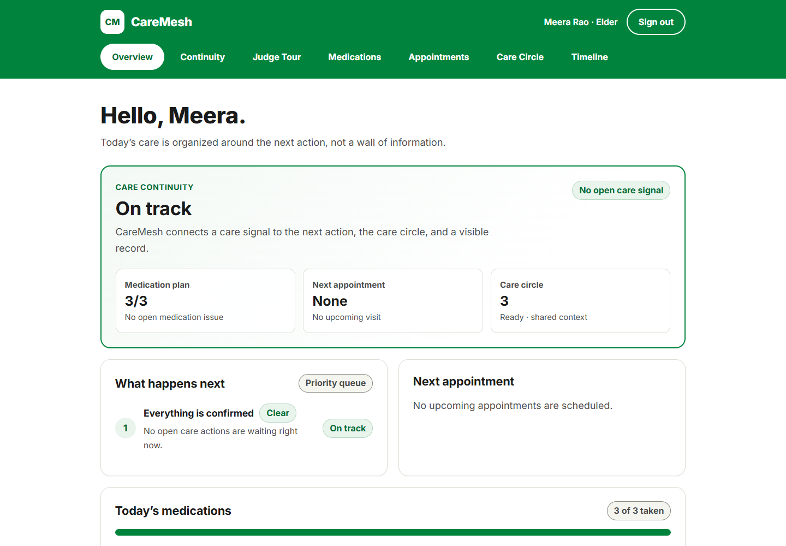

# CareMesh

**Care, connected.**

CareMesh is an elder-first care coordination space for medications, appointments, reminders and a trusted care circle. The elder stays in control of who can see and change their care.

[Live app](https://caremesh-one.vercel.app) · [Architecture](ARCHITECTURE.md) · [Deployment](DEPLOY.md)



## Problem

Care for an older family member is spread across pill schedules, appointment notes, phone calls and group chats. The person receiving care often has the least visibility, while family members and caregivers work from different versions of the same plan.

CareMesh puts the next action, the responsible person and the evidence of what happened in one place.

## Solution

- **Elder, family and caregiver roles** with passcode access and server-side authorization.
- **Medication scheduling and adherence** with taken, missed and overdue states.
- **Appointments** with doctor, date and location.
- **Care circle** permissions controlled by the elder.
- **Reminder workflow** for upcoming medication, missed doses and next appointments.
- **CarePulse timeline** with an audit trail of care events.
- **Daily AI care brief** with a deterministic fallback when Gemini is not configured.
- **Reminder delivery** through Resend when configured, with a safe in-app outbox fallback.
- **Accessibility-first UI**: keyboard focus, semantic labels, large touch targets, readable contrast and reduced-motion support.
- **Cloud Run-ready container** with a health endpoint.

## Proof

- **19/19 tests pass** (`npm test`), covering validation, authorization, reminders, security, passcode hashing, signed sessions, cron authentication, logout, 404s and end-to-end login.
- **Authorization is server-side.** A family session cannot mutate medications or trigger reminders.
- **Passcodes are never stored in plaintext.** They are scrypt-hashed with per-user salts.
- **Sessions are signed.** HttpOnly cookies use HMAC-SHA256; tampered sessions are rejected.
- **Reminder keys are stable.** Upcoming medication reminders are generated once and deduplicated.
- **Production is live.** The deployed app returns HTTP 200 and supports the documented demo login.

## How it works

```text
Browser
  → Node HTTP application
      → auth + signed session cookies
      → REST-style API routes
      → care domain services
      → Gemini adapter (optional)
      → Resend adapter (optional)
      → repository
          → Firestore REST when configured
          → in-memory demo store locally
```

The domain layer is independent of persistence. Local development uses synthetic in-memory data; Cloud Run can use Firestore as shared state. AI inference sits behind an adapter so the product workflow does not depend on one model call.

## Technology

- Node.js HTTP server, no web framework
- Vanilla JavaScript, HTML and CSS
- Google Gemini through Vertex AI (optional)
- Resend email adapter (optional)
- Firestore REST or in-memory store
- Docker, Google Cloud Run, Vercel configuration
- Node's built-in test runner

## Demo

Live: **https://caremesh-one.vercel.app**

Demo accounts use synthetic data only:

| Role | Name | Access code |
|---|---|---|
| Elder | Meera Rao | `1234` |
| Caregiver | Priya Shah | `2468` |
| Family | Arjun Rao | `1357` |

These credentials are intentionally public demo access, not production authentication.

## Run locally

```bash
npm start
```

Open http://localhost:8080.

```bash
npm test
npm run lint
```

Optional production configuration:

| Variable | Purpose |
|---|---|
| `GOOGLE_CLOUD_PROJECT` | Enables Firestore and Vertex AI |
| `GOOGLE_CLOUD_LOCATION` | Vertex AI region |
| `SESSION_SECRET` | Signs session cookies |
| `RESEND_API_KEY` / `MAIL_FROM` | Real reminder email |
| `CRON_SECRET` | Protects the reminder cron endpoint |

## Limitations

- The live app is a demo with synthetic data. It is not for real medical use.
- Demo access codes are public by design. There is no production onboarding, password reset or multi-household tenancy yet.
- Without Firestore configured, state is in-memory and resets when the process restarts.
- Without Resend configured, reminder emails are recorded in the in-app outbox instead of being delivered.
- The AI care brief summarizes existing care data. It does not diagnose, prescribe or replace a clinician.
- The app is optimized for one care recipient and a small circle, not a large care organization.

## Documentation

- [`ARCHITECTURE.md`](ARCHITECTURE.md)
- [`DEPLOY.md`](DEPLOY.md)
- [`CATALYST_SUBMISSION.md`](CATALYST_SUBMISSION.md)
- [`data/README.md`](data/README.md)

## Author

Swapneel Sethi · [GitHub](https://github.com/Swapneel-Sethi)
