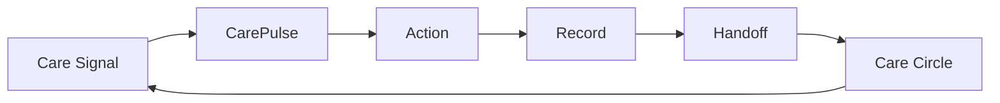
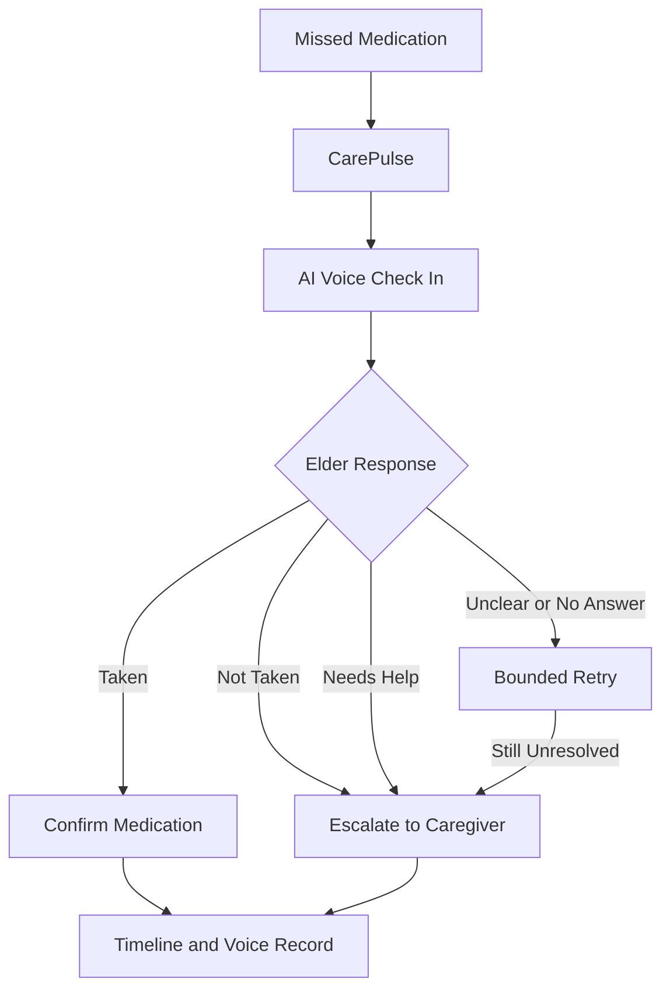
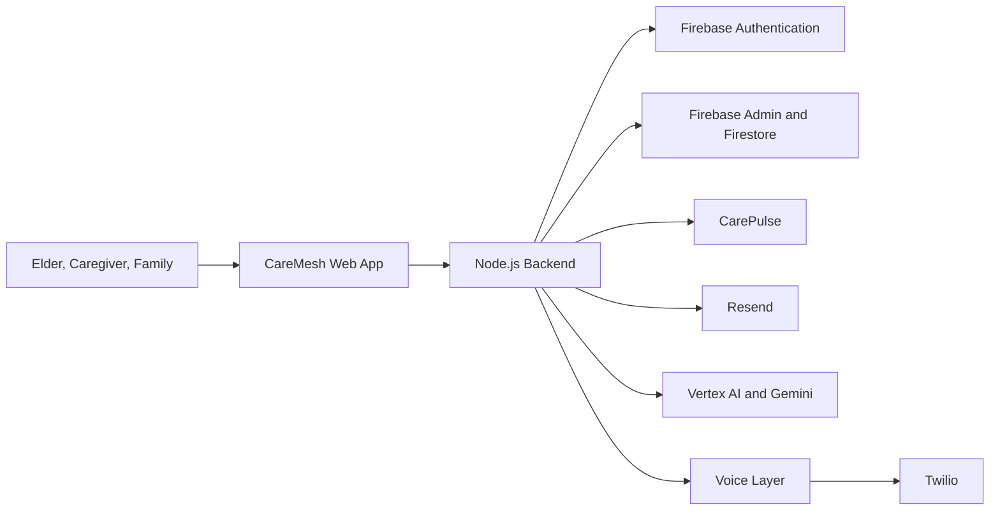

# CareMesh

> **CareMesh is an elder first care coordination platform that turns everyday care signals into coordinated action, records what happened, and keeps the entire care circle aligned.**

**Not another medication reminder. A care continuity system.**

## 30 second summary

Elder care is not one task. It is a chain of medications, appointments, follow ups, family updates, caregiver decisions, and handoffs. A reminder can tell someone that a medication is due. It cannot guarantee that anyone responded, record the outcome, or preserve context for the next person.

CareMesh connects those moments into one shared care state:

```text
Care Signal
    ↓
Action
    ↓
Record
    ↓
Handoff
    ↓
Continuity
```

The system combines role based access, recipient scoped data, medication and appointment workflows, CarePulse automation, an auditable timeline, AI assisted care briefs, email delivery, and a guarded voice escalation architecture. Optional providers have deterministic or local fallbacks, so the core coordination workflow remains demonstrable without telecom or AI infrastructure.

## Why CareMesh is not another reminder app

A traditional reminder treats the notification as the end of the workflow:

```text
Medication due
      ↓
Reminder
      ↓
Done
```

CareMesh treats the reminder as the beginning of a coordination loop:

```text
Care signal
      ↓
CarePulse
      ↓
Next action
      ↓
Elder or caregiver responds
      ↓
Care state updates
      ↓
Timeline records the outcome
      ↓
Care circle receives context
      ↓
The next person knows what happened
```

CareMesh is designed around continuity of care rather than isolated reminders. It acts as a coordination layer between the elder, caregiver, and family, with one underlying state and a visible record of what changed.

## The problem

Shared care fragments easily:

- An elder may miss a medication.
- A caregiver needs to know whether anyone followed up.
- Family members may be elsewhere but still need reliable context.
- Another caregiver may need to take over later.
- Appointments require timing, location, preparation, and notes.
- Important decisions can disappear into private calls and messages.

> **The hardest part of shared care is often not remembering the task. It is preserving context when responsibility moves between people.**

CareMesh makes that context durable. The current care state, the next action, and the activity trail remain visible to the people who are authorized to participate.

## The care continuity loop



| Stage | What it means in CareMesh |
| --- | --- |
| **Care Signal** | A medication is due, a dose is unresolved, or an appointment is approaching. |
| **Action** | The elder confirms a dose, a caregiver follows up, or someone reviews an appointment. |
| **Record** | Medication state, reminder delivery, appointment changes, access activity, and voice outcomes become timeline events. |
| **Handoff** | CareMesh produces a concise summary of the current state and the next coordination step. |
| **Continuity** | Authorized members of the care circle see the same state instead of reconstructing it from scattered conversations. |

This loop is the product model. Features exist to move care through it, not to create disconnected dashboards.

## What CareMesh does

### Medication management

- Creates medication schedules with time, frequency, instructions, and category.
- Tracks `pending`, `taken`, and `missed` states.
- Identifies overdue and unresolved doses.
- Lets authorized elders and caregivers confirm medication state.
- Feeds unresolved medication signals into CarePulse and the voice workflow.
- Records state changes in the timeline.

Medication confirmation is intentionally precise: CareMesh records what the user reported. It does not claim to verify physical ingestion.

### Appointment management

- Adds appointments with doctor, specialty, date, time, location, and notes.
- Places the next upcoming appointment at the front of the experience.
- Includes appointments within the CarePulse reminder window.
- Preserves appointment actions in the shared care context.

### Care circle

CareMesh models three participant roles:

- **Elder:** remains at the center of the care state and manages personal care activity.
- **Caregiver:** supports daily coordination and can act on medications, appointments, reminders, and configured voice calls.
- **Family:** sees the shared context but cannot mutate protected care data.

Google identities begin as `pending`. They receive no care recipient data until explicit membership and role assignment connect them to a recipient.

### CarePulse

CarePulse is the automation layer. It detects:

- medications due within the upcoming window
- unresolved medications that have passed the grace period
- appointments occurring within the next 24 hours

Stable reminder keys suppress repeat processing for the same care event. Scheduled execution is available through a secret protected cron route, while the current scheduled demo actor is scoped to the seeded recipient.

### Timeline

Meaningful care and access activity becomes a visible record, including:

- medication confirmations and missed states
- reminder preparation or delivery
- appointments added
- access sessions and invitation activity
- voice confirmation, failure, or escalation

The timeline turns CareMesh from a collection of forms into an auditable coordination system.

### Care Brief

The Care Brief summarizes structured medication, appointment, profile, and care circle data. When Google Cloud configuration is available, the adapter calls Vertex AI with the configured Gemini model. The prompt explicitly forbids diagnosis, prescribing, and invented medical facts.

Without Vertex AI, CareMesh generates a deterministic brief from the same structured data. The care workflow does not depend on an AI call succeeding.

### Care handoff

The Continuity view creates a plain language handoff with medication status, attention items, the next appointment, care circle members, and the next coordination step. Internal identifiers stay out of the shared summary.

## AI voice medication escalation

CarePulse can extend an unresolved medication signal into a bounded voice workflow:



The current repository implements:

- one shared state machine for Twilio webhooks and the simulator
- conservative intent classification for `TAKEN`, `NOT_TAKEN`, `HELP`, and `UNCLEAR`
- speech and keypad input through TwiML `<Gather>`
- a configurable retry limit capped at three attempts
- official Twilio request signature verification against the external callback URL
- opaque 24 byte session identifiers with a 12 minute expiry
- transactional session claims that block replayed outcomes
- recipient checks that prevent one care circle from driving another circle's session
- masked phone data and no phone numbers in voice call records
- medication updates, caregiver escalation, timeline events, and voice call records
- email fallback when a configured provider cannot start an automated call
- an in app simulator that uses the same outcome pipeline as provider callbacks

> **The simulator allows the complete voice workflow to be demonstrated deterministically without depending on telecom infrastructure.**

Live phone calling is disabled by default. It requires Twilio credentials, a compatible caller ID, explicit recipient consent, an allowed calling window, and publicly reachable webhooks. The implementation and signed webhook paths are tested with synthetic provider data. This repository does not claim that a real recipient call has been completed.

## Why this matters at scale

A caregiver may eventually coordinate care for several elders:

```text
Elder A ──┐
Elder B ──┼── CareMesh ── Caregiver
Elder C ──┘
```

Without a coordination layer, every unresolved event can become another manual call:

```text
Missed dose
    ↓
Caregiver calls
    ↓
Repeat for each elder
```

CareMesh establishes the safer operating model:

```text
Missed dose
    ↓
CarePulse
    ↓
Automated first line check in
    ↓
Routine confirmation is recorded
    ↓
Only unresolved cases reach the caregiver
```

**AI first, human when necessary.** The goal is not to replace caregivers. It is to keep routine coordination from consuming the attention needed for exceptions and human support.

The data layer already scopes records under independent care recipients. The current account mapping and interface present one assigned recipient per session. A caregiver workspace spanning multiple recipients is planned, not claimed as complete.

## Roles and permissions

| Role | View care state | Manage medications | Manage appointments | Run reminders | Place configured voice call | Responsibility |
| --- | --- | --- | --- | --- | --- | --- |
| Elder | Yes | Yes | Yes | Yes | No | Manages personal care state and confirms actions. |
| Caregiver | Yes | Yes | Yes | Yes | Yes | Supports daily coordination and handles escalation. |
| Family | Yes | Read only | Read only | No | No | Maintains awareness without changing care data. |
| Pending | No | No | No | No | No | Waits for explicit recipient membership and role assignment. |

All protected routes resolve the signed session on the server, derive the recipient, verify active membership, and then apply the role gate.

## System architecture



The most important boundary is simple:

```text
Browser
   ↓
CareMesh Backend
   ↓
Firebase Admin
   ↓
Firestore
```

The browser is not the authorization boundary. The backend is. Browsers never receive Firebase Admin credentials and Firestore client rules deny every direct read and write.

The domain workflow is separated from persistence and provider adapters. Local development uses a memory backed store. Configured deployments use Firestore through the Admin SDK. Email, AI, and voice providers can be absent without preventing the core application from starting.

## Security by design

Security controls are tied to specific boundaries in the implementation:

| Control | Purpose |
| --- | --- |
| **scrypt passcode hashes** | Synthetic demo passcodes are stored as salted hashes, never plaintext. Verification uses timing safe comparison. |
| **Firebase ID token verification** | Google identity tokens are verified on the server with revocation checking. New identities default to `pending`. |
| **Signed session cookies** | CareMesh issues HMAC-SHA256 signed, eight hour sessions in `HttpOnly`, `SameSite=Lax` cookies. Production adds `Secure`. |
| **Exact origin validation** | Authentication requests compare protocol, hostname, and port against explicit allowed origins. Prefix lookalikes are rejected. |
| **Recipient isolation** | The server derives `recipientId` from trusted identity data and verifies active care team membership. Browser input is never proof of access. |
| **Role gates** | Elder and caregiver roles can mutate care data. Family is read only. Only caregivers can place provider backed voice calls. |
| **Pending isolation** | Pending users can see only their pending account state and cannot access care data routes. |
| **Bounded input** | JSON payloads are size limited, validated as objects, and checked for field length, time, and date format. |
| **Rate limiting** | The application limits each IP to 60 API requests per minute per running process. |
| **Browser hardening** | CSP, frame denial, MIME sniffing prevention, referrer policy, and no store API caching are set by the server. |
| **Server only Firestore** | Firebase Admin owns database access. `firestore.rules` denies all client reads and writes. |
| **Signed voice webhooks** | Twilio callbacks require the official `twilio.validateRequest` check for the exact public URL and form body. |
| **Opaque voice sessions** | Random session IDs expire after 12 minutes. Recipient and medication IDs do not appear in callback URLs. |
| **Replay protection** | A transaction claims each voice session before mutation, preventing the same callback from applying twice. |
| **Duplicate safe automation** | Stable reminder keys prevent repeated delivery, while Firestore `.create()` atomically reserves missed dose voice claims. |
| **Data minimization** | Phone numbers are masked in responses, provider secrets stay on the server, and dashboard outbox records omit recipients and message bodies. |

## Firestore data model

```text
users/{uid}

careRecipients/{recipientId}
    profiles/{profileId}
    medications/{medicationId}
    appointments/{appointmentId}
    careTeam/{memberId}
    events/{eventId}
    reminders/{reminderId}
    invitations/{invitationId}
    outbox/{messageId}
    voiceCalls/{callId}

voiceSessions/{sessionId}
```

Care data is scoped under `careRecipients/{recipientId}` so medication, appointment, team, audit, reminder, and voice records share the same authorization boundary. `voiceSessions` is top level because an inbound provider callback knows only an opaque session ID. The session resolves the recipient internally, while completed call records return to the recipient scoped hierarchy.

See [`FIREBASE.md`](FIREBASE.md) for the authentication flow, membership model, Firebase configuration, and security rules.

## Google services

### Firebase Authentication

The web app supports Google sign in through Firebase Authentication. The backend verifies the Firebase ID token, provisions a pending account when needed, and converts verified identity into the existing signed CareMesh session.

### Firestore

Firestore stores recipient scoped care data, memberships, invitations, timeline events, reminder claims, outbox metadata, voice sessions, and voice call records when Firebase Admin is configured.

### Vertex AI and Gemini

The Care Brief adapter can call the configured Gemini model through Vertex AI from a Google Cloud runtime with metadata based credentials. Generation is constrained to supplied structured care data and uses low temperature settings. A deterministic fallback remains available.

### Google Cloud readiness

The repository includes a Docker container that binds to `PORT` on `0.0.0.0`, which matches the Cloud Run container contract. No active Cloud Run deployment is claimed.

## Elder first by design

The interface is designed to reduce effort and cognitive load:

- large readable text and high contrast states
- touch targets generally at least 48 pixels high
- one clear next action instead of a dense control surface
- plain status labels for taken, missed, overdue, and upcoming care
- semantic headings, labels, landmarks, and live status regions
- visible keyboard focus and modal focus containment
- a skip link for keyboard navigation
- reduced motion support through `prefers-reduced-motion`
- responsive layouts for smaller screens
- a voice path limited to yes, no, help, and bounded retry choices

This is an accessibility conscious implementation, not a claim of formal certification.

## Engineering quality

**77 automated tests passing.** The suite uses Node's built in test runner and covers:

- medication and appointment validation
- scrypt passcode verification and signed session tamper rejection
- elder, caregiver, family, pending, and unauthenticated authorization paths
- exact origin validation and malicious hostname prefix rejection
- recipient isolation and IDOR prevention
- reminder windows, stable keys, duplicate suppression, and protected cron access
- sanitized outbox responses and timeline persistence
- deterministic voice intent classification
- simulator confirmation, missed dose, help, unclear, and no answer outcomes
- family voice restrictions and caregiver only provider calls
- valid, invalid, and missing Twilio signatures
- forwarded host signature validation
- opaque voice URLs, session expiry, and replay protection
- duplicate missed dose claims
- operation without Twilio, Resend, or Vertex AI credentials
- secret and phone number non disclosure

Verification commands:

```bash
npm test
npm run lint
```

No coverage percentage is claimed because the repository does not currently measure coverage.

## 60 second demo

1. Sign in as **Caregiver** with access code `2468`.
2. Open **Overview** and point to the current signal, next action, care circle, and continuity chain.
3. Open **Medications** and find an unconfirmed dose.
4. Select **Simulate AI call**.
5. Choose **I did not take it**.
6. Show the medication moving to `Missed`.
7. Open **Timeline** and show the CarePulse Voice Agent escalation event.
8. Return to **Continuity** and show how the updated state becomes the next action and handoff.

The simulator exercises the same session claim, medication update, event, call record, and escalation pipeline used by provider callbacks. It does not place a real phone call.

## Demo credentials

**Synthetic demo credentials only. These are not real users or clinical records.**

| Role | Name | Access code |
| --- | --- | --- |
| Elder | Meera Rao | `1234` |
| Caregiver | Priya Shah | `2468` |
| Family | Arjun Rao | `1357` |

## Why CareMesh stands out

1. **It treats care as a coordination problem.** The workflow continues after a reminder is sent.
2. **It creates one shared care state.** Elder, caregiver, and family see the same underlying context through different permissions.
3. **It leaves a continuity trail.** Signals become actions, records, and handoffs instead of disappearing into private conversations.
4. **It escalates deliberately.** Routine automation handles bounded coordination. Unresolved cases move to a caregiver.
5. **It keeps the elder central.** The product is organized around the elder's care state, not around provider infrastructure.
6. **It remains demonstrable without optional services.** Memory persistence, preview outbox behavior, deterministic care briefs, and the voice simulator preserve the core story.
7. **It protects identity and recipient boundaries.** Session, role, membership, origin, provider, and replay controls are explicit in code and tests.
8. **It can evolve without replacing its core model.** Email, AI summaries, and voice all attach to the same signal, action, record, and handoff loop.

## Future evolution

These capabilities are planned. They are not presented as complete:

- a controlled live voice rollout with verified recipients and provider configuration
- multilingual voice prompts and intent handling
- a caregiver workspace spanning multiple care recipients
- configurable escalation rules and notification channels
- stronger personalization of reminder and calling windows
- identification of recurring unresolved care routines
- clinician shareable care summaries
- configurable coordination workflows beyond the seeded medication and appointment paths

## Built as a reusable coordination foundation

CareMesh is care specific, but several cross cutting concerns are already separated from the domain:

- authentication and signed sessions
- role and recipient scoped authorization
- workflow state changes
- notifications and provider adapters
- audit events and handoff summaries
- AI adapters with deterministic fallback
- scheduled automation and duplicate control
- persistence adapters for memory and Firestore

CareMesh already separates many cross cutting concerns from the care domain, making the architecture adaptable to future coordination focused applications. It is not presented as a general purpose framework.

## Technology stack

| Layer | Technology |
| --- | --- |
| Frontend | Semantic HTML, CSS, and vanilla JavaScript |
| Backend | Node.js with the built in HTTP server |
| Authentication | Firebase Authentication, Firebase Admin token verification, signed CareMesh sessions |
| Database | Firestore through Firebase Admin, with a memory fallback for local demos |
| AI | Vertex AI and Gemini adapter with deterministic Care Brief fallback |
| Automation | CarePulse reminder engine and protected Vercel cron routes |
| Email | Resend with preview outbox fallback |
| Voice | Twilio integration, TwiML, deterministic intent classifier, and simulator |
| Hosting | Vercel |
| Container | Docker, ready for the Cloud Run container contract |
| Testing | `node:test` and `node:assert` |
| Security | scrypt, HMAC-SHA256 sessions, role gates, recipient checks, CSP, signed webhooks |

## Quick start

```bash
npm install
npm start
```

Open:

```text
http://localhost:8080
```

The default local experience uses synthetic demo data, deterministic Care Brief generation, preview email delivery, and the voice simulator. Copy [`.env.example`](.env.example) into your local environment configuration when enabling optional services.

Firebase setup is documented in [`FIREBASE.md`](FIREBASE.md). Deployment details are in [`DEPLOY.md`](DEPLOY.md).

## Deployment

The current hosted architecture is:

```text
Vercel
   ↓
CareMesh Node backend
   ↓
Firebase Admin
   ↓
Firestore
```

`vercel.json` packages the public assets with the Node function and configures two daily reminder schedules. The repository also contains a Docker image for Cloud Run deployment. Cloud Run is supported by the container architecture but is not claimed as an active environment.

Real provider features require server environment configuration. Secrets must remain in the deployment platform and must never be committed.

## Honest boundaries

- Medication confirmation is user reported. CareMesh does not verify physical ingestion.
- CareMesh is a coordination tool, not a medical device, diagnostic system, or prescribing system.
- The current interface presents one assigned care recipient per session.
- The seeded demo uses synthetic data only.
- Live Twilio calling is disabled by default and requires provider credentials, a compatible caller ID, explicit consent, a calling window, and public webhooks.
- The voice intent classifier is deliberately narrow. Ambiguous input escalates rather than guessing.
- AI summarization is limited to structured care information already stored in CareMesh.
- Vertex AI, Resend, Twilio, and Firestore depend on deployment configuration. Fallback behavior covers the local demonstration path.
- The application rate limiter is process local. A distributed deployment would need a shared limiter for global enforcement.

## Closing principle

```text
CareMesh
   ↓
Not just reminders
   ↓
A shared care state
   ↓
CarePulse turns signals into actions
   ↓
Actions become records
   ↓
Records create handoffs
   ↓
Handoffs create continuity
   ↓
AI handles bounded routine coordination
   ↓
Humans handle exceptions
```

> **CareMesh is not another reminder app. It is a care continuity system designed to keep the elder, the caregiver, and the family aligned around what needs to happen next.**
